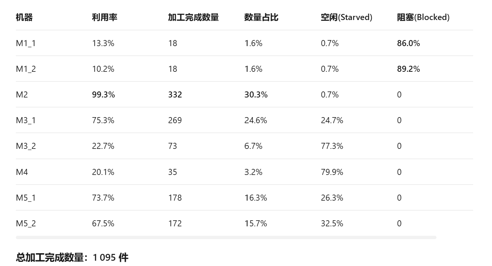
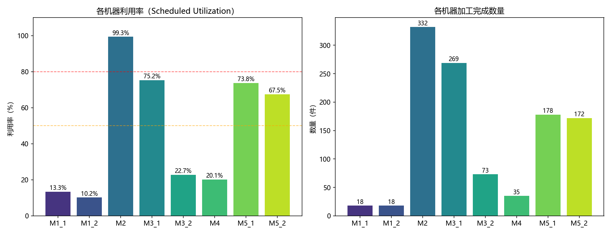
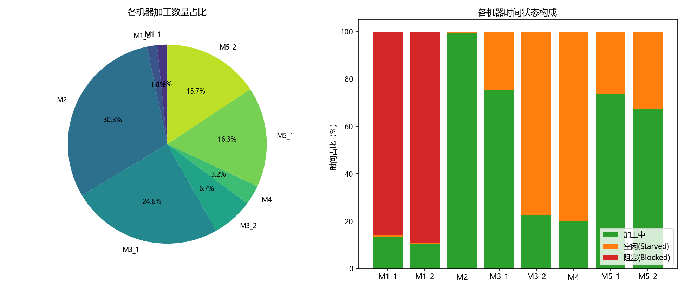

# 案例22 Simio机器状态截图初步分析

记录日期：2026-10-23
证据级别：截图级单次运行观察；截图未显示方案名、随机种子、运行时长和重复编号，不作为多次重复的统计结论。

## 截图归档

截图原件副本保存在 [`docs/evidence/simio_preliminary_20261023/`](evidence/simio_preliminary_20261023/)：

## 读数

| 机器 | 利用率 | 加工完成数 | 空闲/Starved | 阻塞/Blocked |
|---|---:|---:|---:|---:|
| M1_1 | 13.3% | 18 | 0.7% | 86.0% |
| M1_2 | 10.2% | 18 | 0.7% | 89.2% |
| M2 | 99.3% | 332 | 0.7% | 0% |
| M3_1 | 约75.2–75.3% | 269 | 24.7% | 0% |
| M3_2 | 22.7% | 73 | 77.3% | 0% |
| M4 | 20.1% | 35 | 79.9% | 0% |
| M5_1 | 约73.7–73.8% | 178 | 26.3% | 0% |
| M5_2 | 67.5% | 172 | 32.5% | 0% |

表/图的个别百分数相差 0.1 个百分点，视为截图显示的舍入差异；精确分析应读取原始导出数据。

各机器“加工完成数”相加为 **1,095道机器工序**。它不是 1,095 件独立产品，因为一件产品需要经过多道工序。若四种产品的最终路线都经过 M5，M5_1+M5_2=178+172=**350件**才可能与总成品数一致；正式成品数量仍以 Sink/完工实体计数为准。

## 初步判断

1. **M2 是这一运行中的首要瓶颈信号。**其利用率 99.3%、完成332道工序、几乎没有空闲，且没有显示阻塞。结合此前 ZIP 单次 Run 汇总中的 M2 利用率约99.3447%、M2队列曾达到容量50、完工350件，这组截图与该次运行高度吻合；但由于图内没有运行标识，仍需导出元数据确认是不是同一次运行。
2. **M1 两台机器主要被阻塞，而非加工能力用满。**阻塞占比86.0%和89.2%，提示下游接收/转运受限或队列满时上游未释放。单纯增加 M1 数量可能加重在制品和阻塞；先检查阻塞目的地、队列容量、转运规则和状态计时。
3. **M3 两台并行机负荷差异很大。**M3_1完成269道、利用率约75%；M3_2完成73道、利用率22.7%。这可能是路由/派工偏置、队列分配策略或产品流构成导致，应检查两台机器是否真正对同一个缓冲池派工、资源选择是否均衡，以及是否有机器优先级。
4. **M4 当前不是明显的产能瓶颈。**利用率20.1%、Starved 79.9%。在本次运行条件下，优先扩充 M4 缺乏数据支持；但单次截图不能替代匹配重复或变更方案试验。
5. **M5 两台机器较均衡且负荷中高。**完成数178与172接近，利用率约74%与67.5%；目前没有 M1/M2 那样的强瓶颈信号。

### 路线流量一致性警报

按当前路线，令各产品完工数为 `P1=a, P2=b, P3=c, P4=d`，机器工序数理论上应近似满足：

`M1=a+b+d`，`M2=a+c`，`M3=a+b+c`，`M4=a+b+d`，`M5=a+b+c+d`。

截图读数约为 M1=36、M2=332、M3=342、M4=35、M5=350。若暂时忽略窗口末端在制品造成的差异，流量方程会推得近似 `P1≈18, P2≈10, P3≈314, P4≈8`。这意味着完工构成可能高度偏向 P3，与输入比例 30%/25%/25%/20% 差异很大；但该推算**不能代替实际分产品完工计数**，也可能受窗口截点、未完成实体和路线/计数实现影响。

这是当前最值得核对的第二个信号：请直接导出 Sink 处 P1–P4完工数，并核验每件产品实际访问的机器序列。若分产品数确实接近上述推算，应进一步检查调度策略是否使 P1/P2/P4 长时间饥饿，以及类型赋值、路由或入口准入是否出错。

## 下一步验证

1. 补充并保存该截图对应的 Simio 模型版本、方案、运行长度、种子/重复编号、到达/完工总数和配置摘要。
2. 导出 Sink 的总完工与 P1–P4完工计数；导出每台机器状态时间、每个队列最大/均值、外部等待及守恒差。
3. 核对 M3 两机是否共享同一候选队列和相同派工规则；检查对象树与连接，确认没有旧对象或错误优先级。
4. 追踪 M1 被阻塞时的下游对象，确认阻塞是否由满缓冲触发，且没有把阻塞时间算入加工时间。
5. 用固定输入跑确定性路线与守恒测试；通过后再运行配对随机重复。若资源数量允许探索，M2扩容可作为瓶颈诊断方案；若基础资源必须固定，则先研究投料/派工规则，不改机器数。

这些截图是本地材料中第一次直接显示机器状态细分的证据，但尚无足够元数据证明是多次重复汇总。它们支持“先核查 M2、M1阻塞和分产品输出”，不支持直接宣布扩容或优化方案有效。
